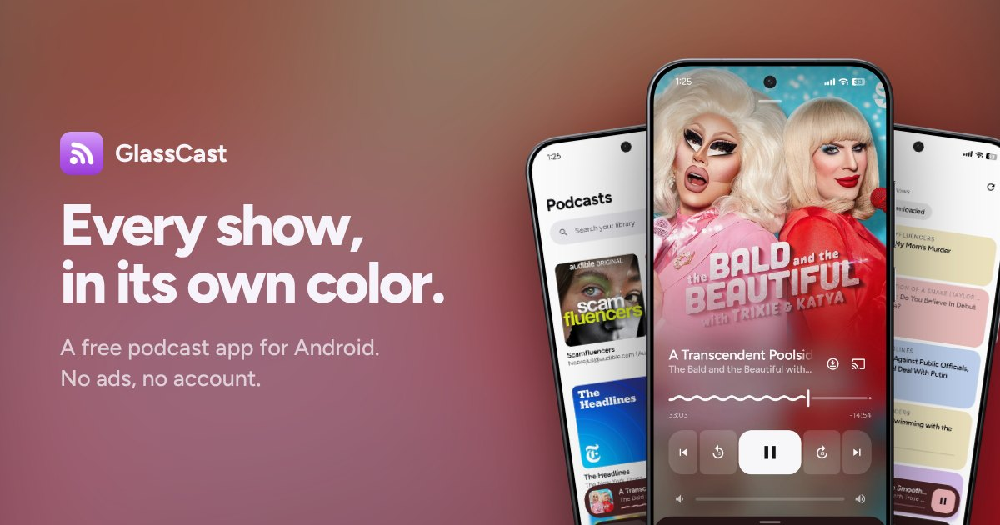
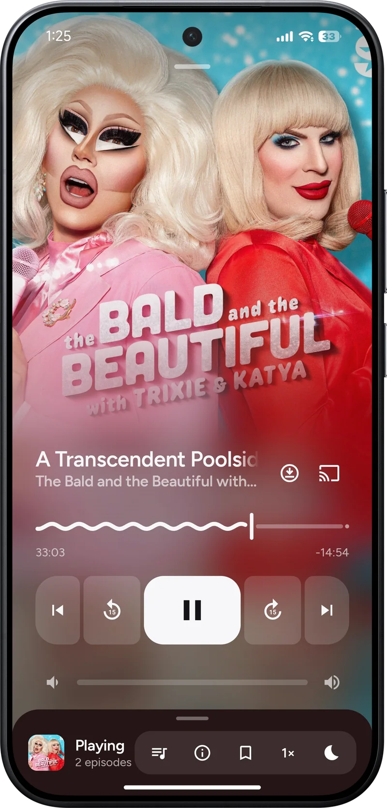
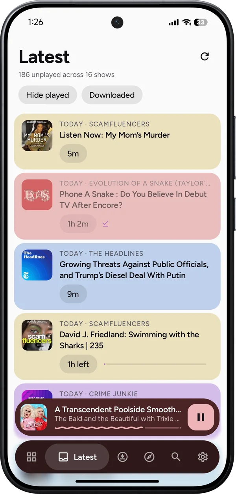
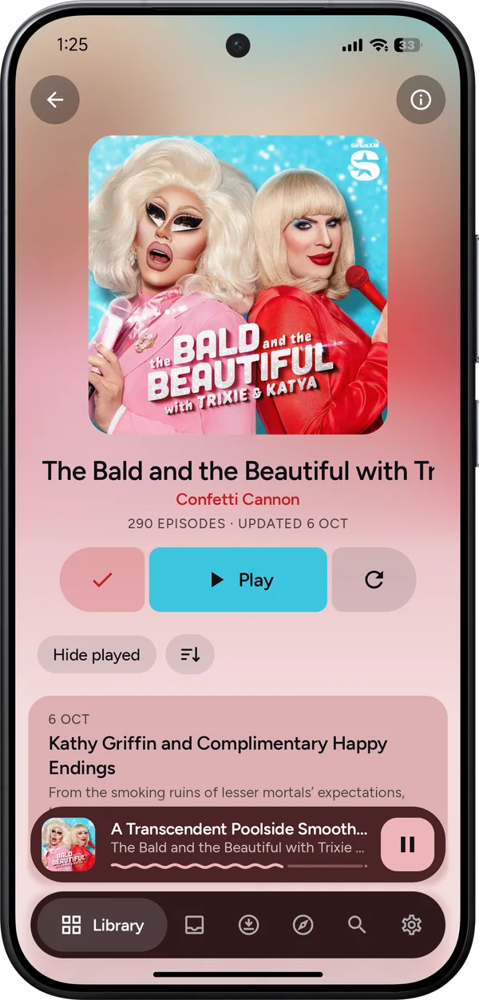
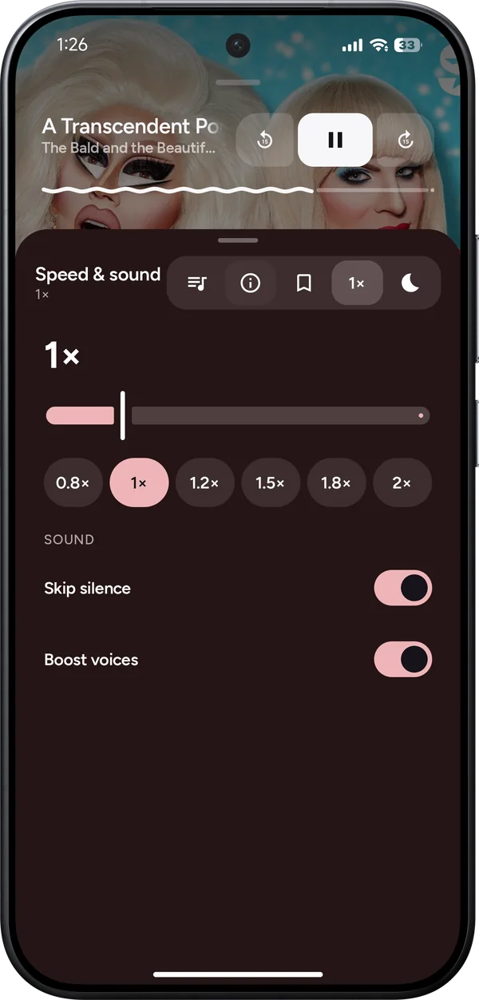

# GlassCast

GlassCast is a podcast app for Android phones and Google TV. I started it after
moving over from an iPhone, because I couldn't find an Android podcast app I
actually liked using.

You can download the latest APK from the
[releases page](https://github.com/anixitea/GlassCast-for-Android/releases/latest).
The app checks that page for updates itself, so you only need to install it once.
There's more about it, in English and Korean, at
[anixitea.github.io/glasscast](https://anixitea.github.io/glasscast/).

  
  
  
  

## What it does

The player takes its colors from the cover of whatever you're listening to, and
so do the mini player and the tab bar.

You can queue episodes by swiping them, read show notes, jump between chapters,
follow along with transcripts, change the speed, skip silences, boost quiet
voices, and set a sleep timer. Shaking the phone restarts the timer. You can
bookmark a moment in an episode and write a note on it.

Discover suggests shows based on the ones you already follow. That's worked out
on your phone. You don't need an account, and nothing about what you listen to
is sent to me. The [privacy policy](https://anixitea.github.io/glasscast/privacy/)
has the details.

It can also tell you when new episodes come out, download episodes for offline
listening (or download a show's new episodes by itself on Wi-Fi), cast to a
Chromecast or Google TV, sync with a gPodder or Nextcloud server, and import or
export OPML if you're bringing your shows from another app. You can sign in
with Google so your shows, progress and bookmarks follow you to every phone
(they're kept in a hidden folder in your own Google Drive, not on a server of
mine), or save them to a backup file instead. There's a home screen widget, and
long-pressing the icon gets you straight to Resume, Latest, Search or Downloads.

The same APK installs on Google TV, where it has its own interface made for the
remote.

It's free, and there are no ads. If you'd like to support it, you can
[buy me a coffee](https://buymeacoffee.com/theglassmaker).

## Android Auto

GlassCast works in Android Auto. Since it's installed from GitHub and not the
Play Store, Android Auto hides it until you allow unknown sources. Open Android
Auto's settings, tap the version number about ten times to unlock developer
settings, then open the menu in the top corner, choose Developer settings, and
turn on Unknown sources.

## Xiaomi and HyperOS

HyperOS stops apps from running in the background unless you tell it not to.
For new-episode notifications, open GlassCast's App info, turn on Autostart,
and set Battery saver to No restrictions.

## OPPO and ColorOS

ColorOS closes background apps even more eagerly. Open GlassCast's App info,
go to Battery usage, and turn on Allow background activity and Allow auto
launch.

## If it crashes

The next time you open GlassCast, Settings has a Crash report row under About.
Tapping Send lets you share the report however you like, by email or in a
[GitHub issue](https://github.com/anixitea/GlassCast-for-Android/issues/new?template=crash-report.yml).
It stays on your device unless you send it, and it's deleted once you do.

## Building it

Open the folder in Android Studio and run it. It needs Android 8.0 or newer.
My notes on how it's put together, and why some things are done the way they
are, are in [docs/DEVELOPMENT.md](docs/DEVELOPMENT.md).

## License

GlassCast is free software under the GNU General Public License v3.0. You can
use it, change it and share it, as long as what you share stays under the same
license with its source available. The full text is in [LICENSE](LICENSE).

## Credits

The typeface is [Figtree](https://github.com/erikdkennedy/figtree) by Erik
Kennedy, used under the SIL Open Font License (see FIGTREE-OFL.txt).
